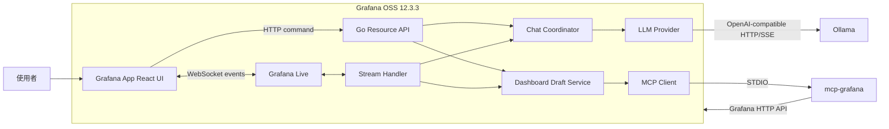
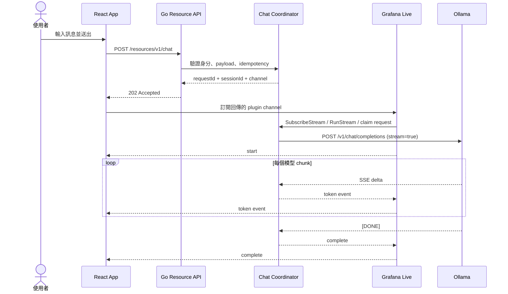
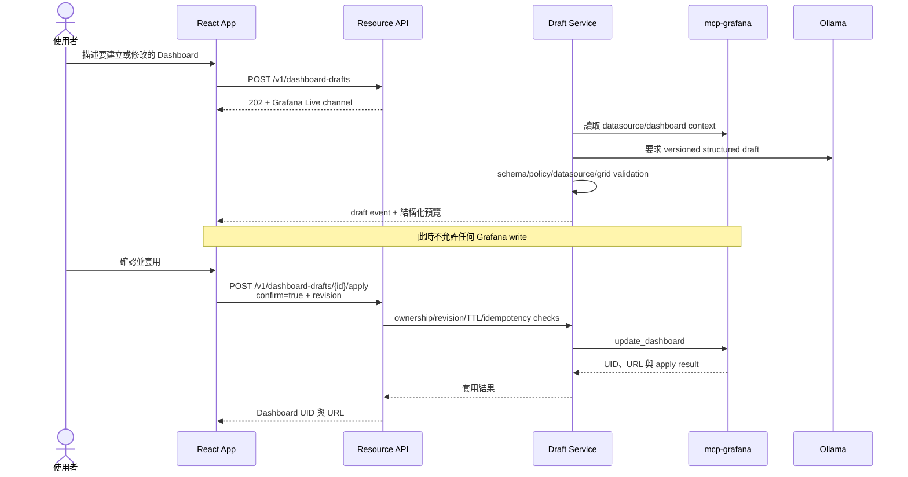

# Grafana Local AI Assistant POC

這是一個純地端的 Grafana App Plugin POC，使用 React UI、Go backend、Grafana Live、Ollama 與 `mcp-grafana`，驗證下列能力：

- 使用者只透過 Grafana UI 與 authentication boundary 操作。
- Browser 不直接連線 Ollama、MCP 或資料庫。
- HTTP Resource API 負責 command；Grafana Live/WebSocket 負責 streaming event。
- LLM 使用 OpenAI-compatible abstraction，預設 provider 為 Ollama。
- Dashboard 修改採「產生草稿 → 預覽 → 使用者確認 → 套用」，模型不能自行寫入 Grafana。

詳細設計與完整驗收契約請參考 [SPEC.md](./SPEC.md)。

## 系統架構



主要元件：

| 元件 | 責任 |
|---|---|
| `AssistantPage` | 對話、Dashboard 模式、local UI state 與草稿預覽 |
| `chatApi` / `dashboardApi` | 呼叫 Grafana Plugin Resource API |
| `liveChat` | 使用 Grafana runtime API 訂閱 plugin-scoped Live channel |
| `ChatCoordinator` | request ownership、idempotency、TTL、claim 與 cancellation |
| `OpenAICompatibleProvider` | 呼叫 `/chat/completions` 並解析 SSE chunks |
| `DashboardDraftService` | 取得 Grafana context、產生並驗證結構化草稿 |
| `mcp-grafana` | 經受控工具存取 datasource、folder 與 dashboard |

## Chat query flow



Command 與 event 被刻意分開：prompt 不會放入 WebSocket subscribe payload；browser 也不會知道 `LLM_BASE_URL` 或 credential。

### Streaming event protocol

事件包含 `version`、`requestId`、`sessionId`、單調遞增的 `sequence` 與 `timestamp`。主要事件類型：

```json
{
  "version": 1,
  "requestId": "uuid",
  "sessionId": "uuid",
  "sequence": 1,
  "type": "token",
  "content": "hello",
  "timestamp": "2026-08-29T12:00:00Z"
}
```

- `start`：backend 已 claim request，模型請求開始。
- `token`：增量文字。
- `complete`：唯一成功 terminal event。
- `error`：唯一失敗 terminal event，內容為正規化錯誤，不洩漏 upstream response。
- `draft`：Dashboard 草稿已建立，可以透過 Resource API 讀取預覽。

取消請求使用：

```text
DELETE /api/plugins/acme-aiassistant-app/resources/v1/chat/{requestId}
```

## Dashboard query/apply flow



## 網路與安全邊界

```text
Host
└── 127.0.0.1:3000 -> Grafana

Docker edge network
└── Grafana（僅用於 localhost port publishing）

Docker internal network
├── Grafana
└── Ollama:11434（沒有 host port）

Docker bootstrap network（一次性）
└── ollama-init -> 下載模型 -> 寫入 ollama-data volume -> exit 0
```

- Ollama 不公開 host port。
- `mcp-grafana` 是 Grafana container 內的 STDIO child process，不公開 network port。
- LLM/MCP credentials 只存在 backend environment。
- Grafana update checks、usage reporting與 suggested-plugin downloads 預設關閉。
- Runtime 使用已準備好的 images/model 時可離線執行。
- `GF_PLUGINS_ALLOW_LOADING_UNSIGNED_PLUGINS` 僅供本機 POC 開發使用。

## 固定版本

| 元件 | Baseline |
|---|---|
| Grafana | `12.3.3` |
| Node.js | `22` |
| Go | `1.26.3` |
| Ollama | `0.11.7` |
| mcp-grafana | `v1.2.0` |
| 預設模型 | `qwen2.5:3b` |

映像包含 Linux AMD64 與 ARM64 plugin executables。Grafana 12.4+ 的 plugin-scoped Live 行為在升級前必須重新執行 E2E 驗證。

## 啟動

### 先決條件

- Docker Desktop 或相容的 Docker Engine/Compose。
- 建議至少保留 6 GB 可用磁碟空間給 images、build cache 與模型。
- Host-side frontend 開發需要 Node 22+。
- Host-side backend 開發需要 Go 1.26.3+ 與 Mage。

### 第一次啟動

```bash
cp .env.example .env
docker compose up -d --build
```

第一次啟動會由 `ollama-init` 下載模型。較低規格的開發機可以先在 `.env` 使用：

```env
LLM_MODEL=qwen2.5:0.5b
```

檢查狀態：

```bash
docker compose ps -a
```

預期結果：

- `grafana`：`Up`
- `ollama`：`Up (healthy)`
- `ollama-init`：`Exited (0)`，代表模型準備成功

開啟 <http://127.0.0.1:3000>。帳密由 `.env` 的 `GRAFANA_ADMIN_USER` 與
`GRAFANA_ADMIN_PASSWORD` 決定；直接複製 `.env.example` 時為 `admin` / `change-me`。
登入後從左側選單進入 **AI Assistant**。

### 常用操作

```bash
# 查看 logs
docker compose logs -f grafana ollama

# 停止但保留 Grafana 與模型資料
docker compose down

# 再次啟動；已下載模型不會重複下載
docker compose up -d

# 驗證 Ollama 沒有 host port（正常時無輸出）
docker compose port ollama 11434
```

> `docker compose down -v` 會刪除 Grafana 資料與已下載模型，除非確定要完全重置，否則不要執行。

## 使用 AI 助理

### 一般對話

1. 開啟 **AI Assistant → AI 助理**。
2. 保持「對話」模式。
3. 輸入問題並按「送出」。
4. 回應會透過 Grafana Live 增量顯示；生成期間可以取消。

### 建立或修改 Dashboard

1. 切換至「產生 Dashboard」。
2. 選擇新增或修改。
3. 輸入 datasource UID；修改時也要輸入 dashboard UID。
4. 描述 dashboard/panel 需求並送出。
5. 檢查結構化草稿、queries、warnings 與 JSON。
6. 確認內容後才按「確認並套用」。

## 建置與測試

本專案沒有傳統 `Makefile`；Go backend 使用 Grafana 官方 Mage targets，定義於 [Magefile.go](./Magefile.go)。

```bash
# 列出 targets
mage -l

# 建置目前平台
mage build:backend

# 建置 Linux binaries
mage build:linux
mage build:linuxARM64

# Go tests
go test ./...

# Frontend
npm ci
npm run typecheck
npm run lint
npm run test:ci
npm run build

# Grafana 必須先運行
npm run e2e
```

若 host 工具鏈版本過舊，以 Docker production build 為準：

```bash
docker compose build grafana
```

## Resource API 摘要

| Method | Path | 用途 |
|---|---|---|
| `GET` | `/resources/v1/health` | Backend health/config label |
| `POST` | `/resources/v1/chat` | 建立 chat request，回傳 Live channel |
| `DELETE` | `/resources/v1/chat/{requestId}` | 取消 request |
| `POST` | `/resources/v1/dashboard-drafts` | 建立 Dashboard draft request |
| `GET` | `/resources/v1/dashboard-drafts/{draftId}` | 讀取結構化草稿 |
| `POST` | `/resources/v1/dashboard-drafts/{draftId}/apply` | 經確認套用草稿 |

完整 Grafana URL prefix 是：

```text
/api/plugins/acme-aiassistant-app/resources
```

## 已知限制

- POC 使用單一 in-memory request/draft registry；backend restart 會失去進行中狀態。
- 對話只存在目前頁面生命週期，不會持久化。
- 目前沒有 HA、多 replica、RAG、SQL tool 或 autonomous agent loop。
- Dashboard preview 是結構化摘要/JSON，不是未儲存 dashboard 的原生 Grafana render。
- 預設模型以 CPU 執行時，首次回應可能較慢。

## 參考文件

- [Grafana plugin tools](https://grafana.com/developers/plugin-tools/)
- [Grafana backend plugins](https://grafana.com/developers/plugin-tools/key-concepts/backend-plugins/)
- [Grafana plugin publishing and signing](https://grafana.com/developers/plugin-tools/publish-a-plugin/)
