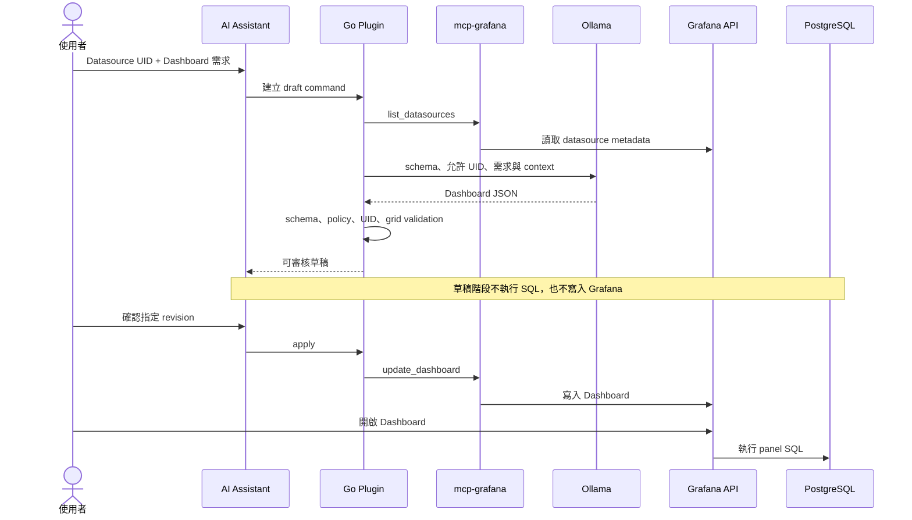

# Dashboard 生成與驗證指南

本指南使用專案內建的 PostgreSQL 範例資料，驗證 AI Assistant 從需求描述、產生草稿、人工審核到寫入 Grafana 的完整流程。

## 測試環境

`docker compose up` 會建立下列資源：

| 資源 | 值 | 說明 |
|---|---|---|
| PostgreSQL service | `postgres:5432` | 僅 Docker internal network 可連線 |
| Database | `observability` | 可由 `.env` 的 `POSTGRES_DB` 覆寫 |
| Grafana datasource | `Demo PostgreSQL` | 啟動時自動 provision |
| Datasource UID | `postgres-demo` | AI Assistant 欄位必須填這個 UID |
| 範例資料表 | `service_requests` | 最近 24 小時、每分鐘三個服務的合成資料 |

Datasource 密碼由 `POSTGRES_PASSWORD` 注入 Grafana 的 `secureJsonData`，不會寫入一般 `jsonData`，PostgreSQL 也沒有發布 host port。

## 資料模型

`service_requests` 每一列代表某個服務在一分鐘內的一組請求觀測值：

| 欄位 | 型別 | 用途 |
|---|---|---|
| `recorded_at` | `timestamptz` | Grafana time series 時間欄位 |
| `service` | `text` | `checkout-api`、`catalog-api` 或 `identity-api` |
| `endpoint` | `text` | API endpoint |
| `status_code` | `integer` | `200`、`404` 或 `500` |
| `duration_ms` | `double precision` | 模擬 request latency |
| `request_count` | `integer` | 該觀測值代表的請求數 |

資料只在 PostgreSQL volume 第一次建立時產生。如果資料時間已超出 Dashboard 選取範圍，可擴大 Grafana 時間範圍，或依照「重置範例資料」重建 volume。

## 啟動與確認

```bash
cp .env.example .env
docker compose up -d --build
docker compose ps -a
```

確認 `grafana`、`ollama`、`postgres` 都是 `Up`，而 `ollama-init` 是 `Exited (0)`。

登入 <http://127.0.0.1:3000> 後，前往 **Connections → Data sources → Demo PostgreSQL**，按 **Save & test**。成功訊息代表 Grafana 能透過 internal network 查詢 PostgreSQL。

也可以先在 Grafana Explore 選擇 **Demo PostgreSQL**，執行：

```sql
SELECT
  $__timeGroupAlias(recorded_at, '5m'),
  service AS metric,
  SUM(request_count) AS value
FROM service_requests
WHERE $__timeFilter(recorded_at)
GROUP BY 1, 2
ORDER BY 1;
```

將時間範圍設為 **Last 24 hours**，應看到三個服務的請求量序列。

## 使用 AI 建立 Dashboard

1. 開啟 **AI Assistant → 產生 Dashboard**。
2. 選擇 **新增**。
3. 在 **Datasource UID** 輸入 `postgres-demo`。
4. `Folder UID` 可留空。
5. 貼上提示詞並按 **送出**。
6. 等待草稿出現，先檢查 warnings 與 JSON。
7. 確認無誤後才按 **確認並套用**。

建議第一次使用明確描述 schema、計算方式與視覺化：

```text
使用 PostgreSQL datasource UID postgres-demo 建立一個名為「Service Operations」的 Dashboard。
資料表 service_requests 有 recorded_at、service、endpoint、status_code、duration_ms、request_count 欄位。

建立以下 panels：
1. Time series：每 5 分鐘的 request_count 總和，依 service 分組。
2. Stat：目前時間範圍的 5xx error rate，計算為 status_code >= 500 的 request_count / 全部 request_count * 100。
3. Time series：每 5 分鐘平均 duration_ms，依 service 分組。
4. Table：各 service 的總請求量、5xx 請求量及平均 latency。

每個 SQL 都必須包含 $__timeFilter(recorded_at)，time series 使用 $__timeGroupAlias(recorded_at, '5m')，datasource UID 必須是 postgres-demo。Dashboard 預設時間範圍為最近 24 小時、每 30 秒 refresh。
```

## 草稿審核重點

AI 回傳的是完整 Grafana Dashboard JSON，但在按下確認前不會寫入 Grafana。至少檢查：

- `title` 符合需求。
- `panels` 數量介於 1 到 12。
- 每個 panel 的 `datasource.uid` 都是 `postgres-demo`。
- SQL 只查詢 `service_requests`，沒有 `INSERT`、`UPDATE`、`DELETE` 或 DDL。
- 每個查詢都有 `$__timeFilter(recorded_at)`，避免忽略 Dashboard 時間範圍。
- Time series 查詢輸出時間、數值與可辨識的 series 名稱。
- `gridPos` 沒有明顯重疊。
- 百分比 panel 的 unit 設定為 percent，latency panel 的 unit 設定為 milliseconds。

目前系統會驗證 Dashboard 結構、panel 數量、grid 與允許的 datasource UID，但尚未在草稿階段執行 SQL，因此會顯示 `QUERY_NOT_EXECUTED` warning。這是預期行為，不代表 SQL 已驗證成功。

## 套用後驗收

按下 **確認並套用** 後：

1. 從 Grafana 左側選單開啟 **Dashboards**。
2. 找到 `Service Operations`。
3. 將時間範圍設為 **Last 24 hours**。
4. 確認四個 panels 都能顯示資料。
5. 打開每個 panel 的 query inspector，確認沒有 SQL error。
6. 改變時間範圍，確認圖表會跟著更新。
7. 依 `service` 分組的圖表應出現三個 series。

模型若產生無效 SQL，Grafana panel 會顯示錯誤。回到 AI Assistant 重新生成草稿，或在 Grafana panel editor 中修正 SQL；不要在未審核 JSON 的情況下反覆套用。

## 修改既有 Dashboard

從 Dashboard URL 取得 UID：

```text
/d/<dashboard-uid>/<slug>
```

在 AI Assistant 選擇 **修改**，填入 `postgres-demo` 與 Dashboard UID。例如：

```text
保留現有 Dashboard 與所有查詢，新增一個 bar chart，顯示目前時間範圍內各 endpoint 的 request_count 總和。新 panel 使用 postgres-demo，SQL 必須包含 $__timeFilter(recorded_at)。不要修改其他 panels。
```

修改模式會先讀取既有 Dashboard，再產生完整替代版本；最後仍需人工確認才會覆寫。

## 重置範例資料

初始化 SQL 只會在空的 PostgreSQL volume 執行。若要重新產生以目前時間為基準的 24 小時資料：

```bash
docker compose down
docker volume rm grafana-llm-poc_postgres-data
docker compose up -d
```

這只刪除本專案的 PostgreSQL 範例資料。不要使用 `docker compose down -v`，因為它也會刪除 Grafana 狀態與 Ollama 模型。

## 生成流程與安全邊界



Browser 只連到 Grafana。PostgreSQL credential、LLM endpoint 與 MCP process 都留在 backend/container 邊界內，模型也不能跳過使用者確認直接套用 Dashboard。
